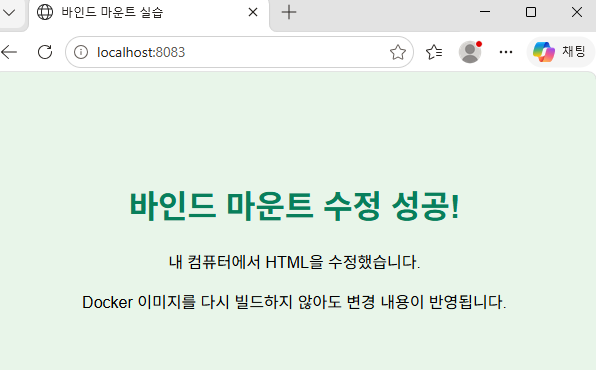
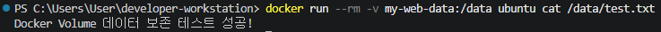

# 개발자용 작업실 구축

## 1. 프로젝트 소개

### 1.1 프로젝트 목적

본 프로젝트는 개발 작업에 필요한 기본 환경을 직접 구축하고, Linux 명령어와 Docker, Git 및 GitHub의 핵심 기능을 실습하는 것을 목적으로 한다.

Windows 환경에서 WSL2 기반 Ubuntu와 Docker Desktop을 연동하여 Linux 개발 환경을 구성하고, Docker 컨테이너를 활용한 웹 서버 구축과 데이터 관리 과정을 수행하였다.

또한 Git을 이용한 버전 관리와 GitHub 원격 저장소 연동을 통해 프로젝트의 변경 이력을 관리할 수 있는 개발 작업 환경을 마련하였다.

### 1.2 주요 실습 내용

- Linux 기본 명령어 및 파일 권한 관리
- Docker 설치 및 컨테이너 실행
- Docker 이미지 생성과 웹 서버 구축
- Bind Mount를 이용한 호스트 파일 공유
- Docker Volume을 이용한 데이터 영속성 확인
- Git 저장소 생성 및 GitHub 원격 저장소 연동

### 1.3 프로젝트 디렉터리 구조

```text
developer-workstation/
├── Dockerfile
├── README.md
├── README_backup.md
├── site/
│   └── index.html
└── evidence/
    ├── 01-bind-mount.png
    ├── 02-docker-volume.png
    ├── 03-docker-ps.png
    ├── 04-project-files.png
    ├── 05-development-environment.png
    ├── 06-linux-permissions.png
    └── 07-github-repository.png
```

프로젝트의 설정 파일과 웹 페이지 소스 코드를 구분하여 관리하고, `evidence` 폴더에는 개발 환경 구성 및 실습 과정에서 확보한 화면 캡처를 정리하였다.

## 2. 개발 환경

### 2.1 시스템 구성

본 프로젝트는 Windows를 기본 운영체제로 사용하고, WSL2와 Ubuntu를 통해 Linux 명령어를 실습하였다. Docker Desktop을 이용해 컨테이너 실행 환경을 구성하였으며, Visual Studio Code에서 프로젝트 파일을 작성하고 관리하였다.

| 구분 | 사용 환경 |
|---|---|
| 운영체제 | Windows |
| Linux 환경 | WSL2 / Ubuntu |
| 컨테이너 플랫폼 | Docker Desktop |
| 개발 편집기 | Visual Studio Code |
| 버전 관리 | Git |
| 원격 저장소 | GitHub |

### 2.2 설치 및 실행 버전 확인

개발 환경이 정상적으로 구성되었는지 확인하기 위해 PowerShell에서 버전을 조회하였다.

**Git 버전 확인**

```powershell
git --version
```

실행 결과:

```text
git version 2.56.0.windows.4
```

**Docker 버전 확인**

```powershell
docker --version
```

실행 결과:

```text
Docker version 29.9.2, build a82e528
```

**Docker 엔진 상태 확인**

```powershell
docker info
```

Docker Client와 Server가 정상적으로 연결되었으며, Docker Desktop이 WSL2 기반 Linux 환경에서 동작하는 것을 확인하였다.

주요 실행 환경:

```text
Context: desktop-linux
Server Version: 29.9.2
Operating System: Docker Desktop
OSType: linux
Architecture: x86_64
Kernel Version: 6.18.54.1-microsoft-standard-WSL2
```

## 3. Linux 환경 및 기본 명령어 실습

### 3.1 Linux 작업 환경 확인

WSL2의 Ubuntu 터미널을 실행하여 현재 작업 위치와 디렉터리 구조를 확인하였다.

| 명령어 | 기능 |
|---|---|
| `pwd` | 현재 작업 디렉터리 확인 |
| `ls -la` | 파일 및 디렉터리 목록 확인 |
| `mkdir` | 디렉터리 생성 |
| `touch` | 파일 생성 |
| `cat` | 파일 내용 확인 |
| `cp` | 파일 복사 |
| `mv` | 파일 및 디렉터리 이동 또는 이름 변경 |
| `rm` | 파일 삭제 |

### 3.2 파일 및 디렉터리 관리

Linux 명령어를 이용하여 연습용 디렉터리와 파일을 생성하고, 파일 복사 및 이름 변경을 수행하였다.

파일에 내용을 작성한 뒤 `cat` 명령어로 저장된 내용을 확인하였다.

### 3.3 파일 권한 관리

Linux에서는 파일과 디렉터리의 접근 권한을 소유자, 그룹, 기타 사용자로 구분하여 관리한다.

`chmod` 명령어를 사용하면 파일의 읽기, 쓰기, 실행 권한을 변경할 수 있다.

| 권한 | 숫자 | 의미 |
|---|---:|---|
| 읽기(Read) | 4 | 파일 내용 읽기 |
| 쓰기(Write) | 2 | 파일 내용 수정 |
| 실행(Execute) | 1 | 파일 실행 |

대표적인 권한 설정 예시는 다음과 같다.

```bash
chmod 600 파일명
chmod 644 파일명
chmod 755 파일명
```

- `600`: 소유자만 읽기 및 쓰기 가능
- `644`: 소유자는 읽기 및 쓰기, 나머지는 읽기 가능
- `755`: 소유자는 모든 권한, 나머지는 읽기 및 실행 가능

`ls -l` 명령어를 통해 변경된 권한을 확인할 수 있다.

## 4. Docker 설치 및 기본 동작 확인

### 4.1 Docker 실행 환경 확인

Docker Desktop을 실행한 후 PowerShell에서 Docker 명령어를 입력하여 클라이언트와 서버가 정상적으로 연결되는지 확인하였다.

```powershell
docker --version
docker info
```

Docker 버전 확인 결과:

```text
Docker version 29.9.2, build a82e528
```

Docker 엔진 주요 정보:

| 항목 | 확인 결과 |
|---|---|
| Docker Context | desktop-linux |
| Server Version | 29.9.2 |
| Operating System | Docker Desktop |
| OSType | linux |
| Architecture | x86_64 |
| 실행 커널 | WSL2 기반 Linux |

### 4.2 Hello World 컨테이너 실행

Docker 설치 및 컨테이너 실행 기능을 확인하기 위해 `hello-world` 이미지를 실행하였다.

```powershell
docker run hello-world
```

실행 결과:

```text
Hello from Docker!
This message shows that your installation appears to be working correctly.

The Docker client contacted the Docker daemon.
The Docker daemon pulled the "hello-world" image.
The Docker daemon created a new container.
The output was streamed to the terminal.
```

이를 통해 Docker 클라이언트와 데몬의 통신, 이미지 다운로드, 컨테이너 생성 및 실행이 정상적으로 이루어지는 것을 확인하였다.

## 5. Docker 이미지와 컨테이너 이해

### 5.1 이미지와 컨테이너의 차이

Docker 이미지(Image)는 컨테이너를 생성하기 위한 실행 환경과 파일을 포함한 읽기 전용 템플릿이다.

컨테이너(Container)는 이미지를 기반으로 생성되어 실제 프로그램을 실행하는 독립적인 환경이다.

| 구분 | Docker 이미지 | Docker 컨테이너 |
|---|---|---|
| 역할 | 실행 환경의 템플릿 | 프로그램 실행 단위 |
| 상태 | 읽기 전용 | 실행 중 또는 종료 |
| 생성 | Dockerfile을 이용해 빌드 | 이미지로부터 생성 |
| 관리 명령어 | `docker images` | `docker ps -a` |

### 5.2 컨테이너 목록 확인

실행 중인 컨테이너뿐 아니라 종료된 컨테이너까지 확인하기 위해 다음 명령어를 사용하였다.

```powershell
docker ps -a
```

실습 당시 주요 컨테이너 상태:

| 컨테이너 이름 | 이미지 | 상태 | 용도 |
|---|---|---|---|
| my-web-bind-container | nginx:alpine | 실행 중 | Bind Mount 웹 서버 |
| my-web-server-container | my-web-server:1.0 | 종료 | Nginx 웹 서버 실습 |
| ubuntu-practice | ubuntu | 종료 | Linux 명령어 실습 |
| sweet_ardinghelli | hello-world | 종료 | Docker 설치 확인 |

컨테이너는 실행이 끝나면 종료 상태가 되며, 삭제하지 않는 한 `docker ps -a` 명령어로 이력을 확인할 수 있다.

### 5.3 이미지 목록 확인

```powershell
docker images
```

실습 환경에서 사용한 주요 이미지:

| 이미지 | 용도 |
|---|---|
| nginx:alpine | 웹 서버 실행 |
| my-web-server:1.0 | 직접 작성한 Dockerfile로 빌드한 이미지 |
| ubuntu | Linux 명령어 및 Volume 실습 |
| hello-world | Docker 설치 및 실행 확인 |

이미지는 컨테이너를 생성하는 기반이며, 하나의 이미지로 여러 컨테이너를 만들 수 있다.

## 6. Nginx 웹 서버 구축

### 6.1 Dockerfile 작성

Nginx 기반의 웹 서버 이미지를 생성하기 위해 Dockerfile을 작성하였다.

```dockerfile
FROM nginx:alpine

COPY site/index.html /usr/share/nginx/html/index.html

EXPOSE 80
```

각 명령어의 역할은 다음과 같다.

| 명령어 | 설명 |
|---|---|
| `FROM` | 기본 이미지 지정 |
| `COPY` | 호스트의 파일을 이미지 내부로 복사 |
| `EXPOSE` | 컨테이너가 사용할 포트 표시 |

### 6.2 웹 페이지 작성

`site/index.html` 파일에 HTML 문서를 작성하여 Nginx 기본 페이지 대신 직접 만든 웹 페이지가 표시되도록 구성하였다.

웹 페이지에는 Docker 실습 내용과 데이터 변경 결과를 확인할 수 있는 문구를 작성하였다.

### 6.3 이미지 빌드

Dockerfile이 있는 프로젝트 루트 디렉터리에서 다음 명령어를 실행하였다.

```powershell
docker build -t my-web-server:1.0 .
```

빌드가 완료되면 `my-web-server:1.0`이라는 이름의 Docker 이미지가 생성된다.

### 6.4 컨테이너 실행

생성한 이미지를 이용하여 Nginx 컨테이너를 실행하였다.

```powershell
docker run -d --name my-web-server-container -p 8082:80 my-web-server:1.0
```

호스트의 8082번 포트와 컨테이너의 80번 포트를 연결하여 웹 브라우저에서 접속할 수 있도록 설정하였다.

### 6.5 웹 서버 접속 확인

웹 브라우저에서 다음 주소로 접속하여 웹 페이지가 정상적으로 표시되는지 확인하였다.

```text
http://localhost:8082
```

이를 통해 Docker 이미지 빌드, 컨테이너 실행, 포트 연결 및 웹 서버 접근 과정을 확인하였다.

## 7. Bind Mount와 Docker Volume을 이용한 데이터 관리

### 7.1 Bind Mount 구성

Bind Mount는 호스트 컴퓨터의 특정 디렉터리를 컨테이너 내부 디렉터리와 연결하는 기능이다.

이를 이용하면 호스트에서 파일을 수정했을 때 컨테이너 내부에서도 변경된 내용을 확인할 수 있다.

다음 명령어를 사용하여 프로젝트의 `site` 폴더를 Nginx 컨테이너에 연결하였다.

```powershell
docker run -d --name my-web-bind-container -p 8083:80 -v "${PWD}\site:/usr/share/nginx/html:ro" nginx:alpine
```

주요 옵션:

| 옵션 | 기능 |
|---|---|
| `-d` | 백그라운드 실행 |
| `--name` | 컨테이너 이름 지정 |
| `-p 8083:80` | 호스트 8083번 포트와 컨테이너 80번 포트 연결 |
| `-v` | 호스트와 컨테이너 디렉터리 연결 |
| `:ro` | 컨테이너에서 읽기 전용으로 연결 |

### 7.2 호스트 파일 수정 및 웹 페이지 반영

호스트 컴퓨터의 `site/index.html`을 수정한 뒤 브라우저에서 다음 주소로 접속하였다.

```text
http://localhost:8083
```

웹 페이지에 수정한 내용인 '바인드 마운트 수정 성공!'이 표시되는 것을 확인하였다.

이를 통해 Docker 이미지를 다시 빌드하지 않아도 호스트 파일의 변경 내용이 컨테이너에 반영되는 것을 확인하였다.



### 7.3 Docker Volume 생성 및 데이터 저장

Docker Volume은 컨테이너의 생명주기와 별도로 데이터를 보존할 수 있는 저장 공간이다.

다음 명령어로 Volume을 생성하였다.

```powershell
docker volume create my-web-data
```

Volume에 테스트 파일을 생성하고 내용을 저장하였다.

```powershell
docker run --rm -v my-web-data:/data ubuntu sh -c "echo 'Docker Volume 데이터 보존 테스트 성공!' > /data/test.txt"
```

### 7.4 컨테이너 삭제 후 데이터 확인

테스트 컨테이너를 종료하고 삭제한 뒤, 동일한 Volume을 다시 연결하여 파일 목록과 내용을 확인하였다.

```powershell
docker run --rm -v my-web-data:/data ubuntu sh -c "ls -l /data && cat /data/test.txt"
```

실행 결과:

```text
total 4
-rw-r--r-- 1 root root 49 Nov 1 01:11 test.txt
Docker Volume 데이터 보존 테스트 성공!
```

컨테이너를 삭제한 후에도 Volume 내부의 데이터가 유지되는 것을 확인하였다.



### 7.5 Bind Mount와 Docker Volume 비교

| 구분 | Bind Mount | Docker Volume |
|---|---|---|
| 저장 위치 | 호스트의 지정 폴더 | Docker가 관리하는 저장 공간 |
| 주요 목적 | 호스트와 파일 공유 | 데이터 영속성 확보 |
| 파일 수정 | 호스트에서 직접 수정 가능 | Volume을 연결한 컨테이너에서 관리 |
| 활용 예시 | HTML, 소스 코드 공유 | 데이터베이스, 서비스 데이터 보존 |

## 8. Git 및 GitHub 연동

### 8.1 Git 저장소 초기화

프로젝트 디렉터리에서 Git 저장소를 생성하고 기본 브랜치를 `main`으로 설정하였다.

```powershell
git init
git branch -M main
```

프로젝트에 사용할 Git 사용자 정보를 설정하였다.

```powershell
git config user.name "GitHub 사용자 이름"
git config user.email "GitHub 등록 이메일"
```

### 8.2 변경 파일 등록 및 커밋

프로젝트 파일을 Git 관리 대상으로 등록한 뒤 커밋을 생성하였다.

```powershell
git add .
git commit -m "개발자 작업실 구축 및 Docker 실습 완료"
```

커밋 결과:

```text
afa6ad1 개발자 작업실 구축 및 Docker 실습 완료
```

### 8.3 GitHub 원격 저장소 연결

GitHub에 생성한 원격 저장소를 로컬 프로젝트와 연결하였다.

```powershell
git remote add origin https://github.com/kululu81/E1-1.git
```

원격 저장소 연결 상태 확인:

```powershell
git remote -v
```

실행 결과:

```text
origin  https://github.com/kululu81/E1-1.git (fetch)
origin  https://github.com/kululu81/E1-1.git (push)
```

### 8.4 GitHub에 프로젝트 업로드

로컬 저장소의 커밋을 GitHub 원격 저장소에 업로드하였다.

```powershell
git push -u origin main
```

업로드 후 커밋과 작업 상태를 확인하였다.

```powershell
git log -1 --oneline
git status
```

확인 결과:

```text
afa6ad1 (HEAD -> main, origin/main) 개발자 작업실 구축 및 Docker 실습 완료

On branch main
Your branch is up to date with 'origin/main'.

nothing to commit, working tree clean
```

로컬 저장소와 GitHub 원격 저장소의 커밋이 일치하며, 작업 디렉터리에 미커밋 변경 사항이 없는 것을 확인하였다.

GitHub 저장소: https://github.com/kululu81/E1-1

## 9. 문제 해결 및 데이터 관리

### 9.1 Git 저장소 관련 문제

Git 명령어를 실행했을 때 저장소가 초기화되지 않았다는 오류가 발생할 수 있다.

**발생 원인**

현재 디렉터리가 Git 저장소로 초기화되지 않은 경우 발생한다.

**해결 방법**

```powershell
git init
```

저장소를 초기화한 후 다시 Git 명령어를 실행한다.

### 9.2 Docker 컨테이너 실행 관련 문제

컨테이너가 종료된 상태에서는 실행 중인 컨테이너 목록에 표시되지 않는다.

**확인 방법**

```powershell
docker ps
docker ps -a
```

- `docker ps`: 현재 실행 중인 컨테이너 확인
- `docker ps -a`: 종료된 컨테이너를 포함한 전체 목록 확인

종료된 컨테이너를 다시 실행하려면 다음 명령어를 사용할 수 있다.

```powershell
docker start 컨테이너명
```

### 9.3 포트 충돌 문제

웹 서버 실행 시 이미 사용 중인 포트를 지정하면 컨테이너 실행에 실패할 수 있다.

**확인 방법**

```powershell
netstat -ano | findstr :8083
```

출력 결과에서 해당 포트를 사용하는 프로세스의 PID를 확인할 수 있다.

프로세스의 상세 정보는 다음 명령어로 확인한다.

```powershell
tasklist /FI "PID eq 프로세스번호"
```

불필요한 프로세스가 맞는지 확인한 후에만 종료해야 한다. 다른 프로그램이 사용하는 포트라면 Docker의 호스트 포트를 변경하는 방법도 있다.

### 9.4 데이터 백업 및 복구

Docker Volume에 저장된 데이터는 컨테이너를 삭제해도 유지되지만, Volume 자체를 삭제하면 데이터가 사라질 수 있다.

따라서 중요한 데이터는 별도 백업을 유지하는 것이 안전하다.

**Volume 백업 예시**

```powershell
docker run --rm -v my-web-data:/data -v "${PWD}:/backup" ubuntu tar czf /backup/my-web-data-backup.tar.gz -C /data .
```

**Volume 복구 예시**

```powershell
docker run --rm -v my-web-data:/data -v "${PWD}:/backup" ubuntu tar xzf /backup/my-web-data-backup.tar.gz -C /data
```

위 명령어는 현재 프로젝트 폴더에 백업 파일을 생성하고, 해당 파일의 내용을 Volume에 복원하는 예시이다.

실제 데이터 복구 시에는 기존 데이터를 덮어쓸 수 있으므로 백업 파일과 복구 대상 Volume을 먼저 확인해야 한다.

### 9.5 Windows와 Linux 경로 차이

Windows PowerShell과 WSL2 Ubuntu는 파일 경로를 표현하는 방식이 다르다.

| 구분 | 경로 예시 |
|---|---|
| Windows | `C:\Users\User\developer-workstation` |
| WSL2 Ubuntu | `/mnt/c/Users/User/developer-workstation` |
| Ubuntu 홈 디렉터리 | `~/developer-workstation-practice` |

Windows 경로와 Linux 경로를 구분하여 사용하면 파일 접근 및 Docker 볼륨 연결 과정에서 발생하는 오류를 줄일 수 있다.

## 10. 프로젝트 최종 결과

### 10.1 구축 결과

이번 프로젝트를 통해 Windows 환경에서 WSL2 기반 Ubuntu와 Docker Desktop을 연동한 개발 작업 환경을 구축하였다.

주요 실습 결과는 다음과 같다.

| 실습 항목 | 수행 결과 |
|---|---|
| Linux 환경 구성 | WSL2 Ubuntu 실행 및 기본 명령어 실습 |
| 파일 권한 관리 | chmod 600, 644, 755 적용 및 실행 확인 |
| Docker 환경 구성 | Docker Client와 Server 연결 확인 |
| 컨테이너 실행 | hello-world 컨테이너 정상 실행 |
| 웹 서버 구축 | Nginx 이미지 빌드 및 웹 페이지 접속 확인 |
| Bind Mount | 호스트 파일 수정 내용의 웹 페이지 반영 확인 |
| Docker Volume | 컨테이너 삭제 후 데이터 유지 확인 |
| Git 관리 | 로컬 저장소 생성 및 커밋 |
| GitHub 연동 | 원격 저장소에 프로젝트 업로드 |

### 10.2 프로젝트 파일 및 실습 증거

실습 과정에서 생성한 소스 파일과 실행 결과를 프로젝트 디렉터리에 정리하였다.

```text
developer-workstation/
├── Dockerfile
├── README.md
├── README_backup.md
├── site/
│   └── index.html
└── evidence/
    ├── 01-bind-mount.png
    ├── 02-docker-volume.png
    ├── 03-docker-ps.png
    ├── 04-project-files.png
    ├── 05-development-environment.png
    ├── 06-linux-permissions.png
    └── 07-github-repository.png
```

### 10.3 마무리

이번 실습을 통해 Linux 명령어와 파일 권한 관리, Docker 이미지 및 컨테이너의 동작 원리, 웹 서버 구축, 데이터 공유와 영속성의 차이를 이해하였다.

또한 Git과 GitHub를 연동하여 프로젝트의 변경 이력을 관리하고 원격 저장소에 결과물을 업로드하는 과정을 수행하였다.

이를 바탕으로 향후 개발 프로젝트에서도 재사용할 수 있는 기본적인 개발 환경을 마련하였다.
